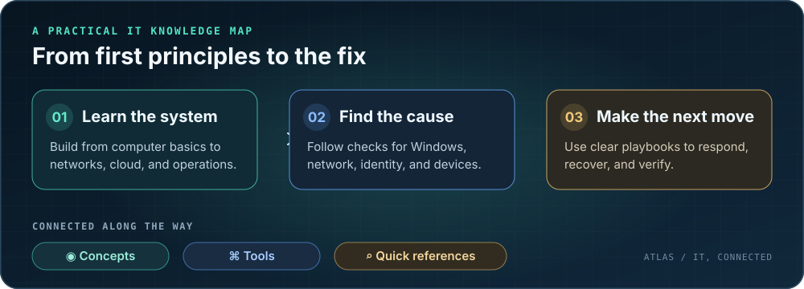

  
    
  <h1>Atlas</h1>
  <strong>One connected atlas for learning IT, fixing problems, and keeping services running.</strong>
    
  <a href="demo/IT-Atlas.html">✦ Explore the interactive demo</a>
  &nbsp; · &nbsp;
  <a href="vault/IT-Atlas/Start%20here.md">🧭 Open the vault</a>
  &nbsp; · &nbsp;
  <a href="CONTRIBUTING.md">✍️ Contribute</a>
    
  
  
  
  

 

## Find your way through IT

On a ticket? Start with the checks. Learning IT? Follow the path. An alert fired? Open a playbook. **Atlas links each step to the tools and concepts behind it.**

 

  

Each path links to relevant concepts, tools, vendor notes, and quick references.

 

## The atlas at a glance

<strong>76</strong> guides &nbsp;·&nbsp; <strong>348</strong> tools &nbsp;·&nbsp; <strong>133</strong> concepts <strong>48</strong> playbooks &nbsp;·&nbsp; <strong>170</strong> vendor notes

 

## Pick a starting point

| 🪄 I want to… | Go here |
| --- | --- |
| Start a new IT career | [The 10-week learning path](vault/IT-Atlas/00%20Home/Learning%20path/Learning%20path.md) |
| Work through a common support issue | [Help desk guides](vault/IT-Atlas/17%20Help%20Desk/Help%20Desk.md) |
| Respond to an alert | [Incident playbooks](vault/IT-Atlas/30%20Playbooks/Playbooks.md) |
| Get my bearings | [Home: the main map](vault/IT-Atlas/00%20Home/Home.md) |
| Look up a product | [The tool database](vault/IT-Atlas/00%20Home/Tool%20database.md) |
| Check a port, log path, or event ID | [Reference sheets](vault/IT-Atlas/40%20Reference/Reference.md) |

 

## See it in motion

**[Open the standalone interactive atlas ↗](demo/IT-Atlas.html)** in a modern browser. No build step or server needed. It’s a visual overview of the same world mapped by the full vault.

## Get the full vault

1. Install [Obsidian](https://obsidian.md/).
2. Clone or download this repository.
3. In Obsidian, choose **Open folder as vault** and select `vault/IT-Atlas/`.
4. Open **Start here**, then visit **Home** for the big picture.

The included `setup-it-atlas.sh` and `setup-it-atlas.ps1` scripts provide guided first-time setup. Matching `update-` scripts back up an existing vault before updating it. Review each script before running it.

  
<strong>Optional extras: Dataview and the 3D Gesture Graph</strong>

   
  Dataview powers live tables in the vault. Gesture Graph adds a 3D view of the connected notes; hand control is optional and requests camera access only when enabled. Review the plugin’s <a href="vault/IT-Atlas/.obsidian/plugins/gesture-graph/README.md">privacy and network notes</a> and <a href="vault/IT-Atlas/.obsidian/plugins/gesture-graph/THIRD_PARTY_NOTICES.txt">third-party notices</a> before enabling community plugins.

 

## Made to be useful—and checked

Notes are written in plain English, organized by experience level, and linked across tools, concepts, and response steps. Product details change, so verify time-sensitive facts against current vendor documentation and your organization's procedures before acting. Some entries are marked for verification.

**Want to help?** Corrections, sources, and practical additions are welcome. See the [contribution guide](CONTRIBUTING.md). Please keep real customer, employer, host, address, credential, and incident data out of examples and issues.

 

  🧭 Keep learning. Keep mapping. Find the next step.

Bundled plugins and dependencies retain their own licenses and notices. No project-wide license is included yet.
