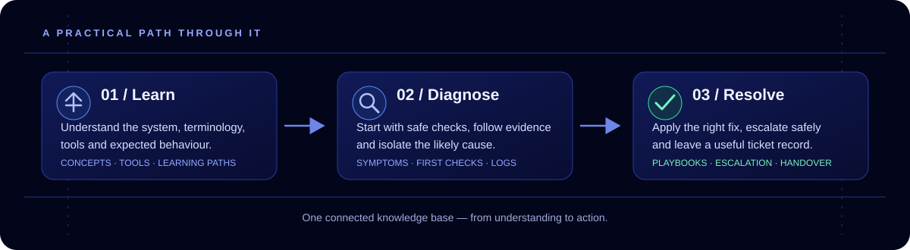

# Atlas

  

  <strong>One connected atlas for learning IT, troubleshooting with confidence, and keeping services running.</strong>

  <a href="demo/IT-Atlas.html"><strong>Explore the interactive demo ↗</strong></a>
  &nbsp;·&nbsp;
  <a href="vault/IT-Atlas/Start%20here.md">Open the Obsidian vault</a>
  &nbsp;·&nbsp;
  <a href="CONTRIBUTING.md">Contribute</a>

  
  

---

## From question to next step

Whether you're learning the fundamentals, working a support ticket, or responding to an alert, Atlas connects **the concept, the tool, the checks, and the playbook** instead of leaving them as isolated notes.

  

## Explore Atlas

| Start with… | Use it for |
| --- | --- |
| [Interactive demo](demo/IT-Atlas.html) | Browse the knowledge map, filter content by experience level, search common fixes, and open the interactive graph. |
| [Home map](vault/IT-Atlas/00%20Home/Home.md) | Navigate categories, concepts, tools, references, and incident playbooks. |
| [10-week learning path](vault/IT-Atlas/00%20Home/Learning%20path/Learning%20path.md) | Build foundational IT knowledge progressively, from computer basics through NOC operations. |
| [Help desk guides](vault/IT-Atlas/17%20Help%20Desk/Help%20Desk.md) | Follow practical first checks, technical troubleshooting, escalation cues, and ticket-writing templates. |
| [Incident playbooks](vault/IT-Atlas/30%20Playbooks/Playbooks.md) | Work through common operational alerts using repeatable steps. |
| [Reference sheets](vault/IT-Atlas/40%20Reference/Reference.md) | Quickly look up ports, Windows event IDs, logs, and common commands. |
| [Tool database](vault/IT-Atlas/00%20Home/Tool%20database.md) | Scan the tools used across IT operations and service delivery. |

## What's inside

Atlas is organized around the way IT work actually happens:

- **Learn:** plain-English concepts, a structured learning path, and career tracks from junior technician to senior engineer.
- **Troubleshoot:** help desk guides with safe first steps, deeper technician checks, common causes, and escalation guidance.
- **Respond:** incident playbooks that turn alerts into a clear first-five-minutes workflow and a useful ticket update.
- **Connect the dots:** links between products, concepts, vendors, operational procedures, and reference material.
- **Keep exploring:** a visual, interactive graph and a local-first Obsidian vault.

The vault currently advertises **76 help desk guides, 348 tools, 133 concepts, 48 playbooks, and 90 vendor notes**. Treat these as a content snapshot; validate them against the vault before publishing an updated release.

## Get started

### Browse the interactive demo

Open [the standalone Atlas demo](demo/IT-Atlas.html) in a modern browser. It does not require a build step or a running server.

### Open the full vault

1. Install [Obsidian](https://obsidian.md/).
2. Clone or download this repository.
3. In Obsidian, choose **Open folder as vault** and select `vault/IT-Atlas/`.
4. Open [Start here](vault/IT-Atlas/Start%20here.md), then go to [Home](vault/IT-Atlas/00%20Home/Home.md).

The repository includes guided setup and update scripts for supported platforms: `setup-it-atlas.sh`, `setup-it-atlas.ps1`, `update-it-atlas.sh`, and `update-it-atlas.ps1`. Review scripts before running them. The update scripts are designed to back up an existing vault before updating it.

  
<strong>Optional Obsidian features and privacy notes</strong>

  The Dataview community plugin powers live tables in the vault. Gesture Graph adds a 3D view of linked notes; hand control is optional and requests camera access only when enabled. Before enabling community plugins, review the [Gesture Graph privacy and network notes](vault/IT-Atlas/.obsidian/plugins/gesture-graph/README.md) and its [third-party notices](vault/IT-Atlas/.obsidian/plugins/gesture-graph/THIRD_PARTY_NOTICES.txt).

## Quality and contributions

Atlas is a community knowledge base, not a substitute for your organization's procedures. Product names, ownership, ports, log paths, and lifecycle details can change; verify time-sensitive information against current vendor documentation before acting. Some entries are explicitly marked for verification.

Corrections and practical additions are welcome. See [Contributing](CONTRIBUTING.md). Keep examples fictional: never commit real customer details, employer or host names, addresses, account identifiers, credentials, screenshots, or incident records. Bundled plugins retain their own licenses and notices. No project-wide license is included yet.

---

Keep learning. Keep mapping. Find the next step.

