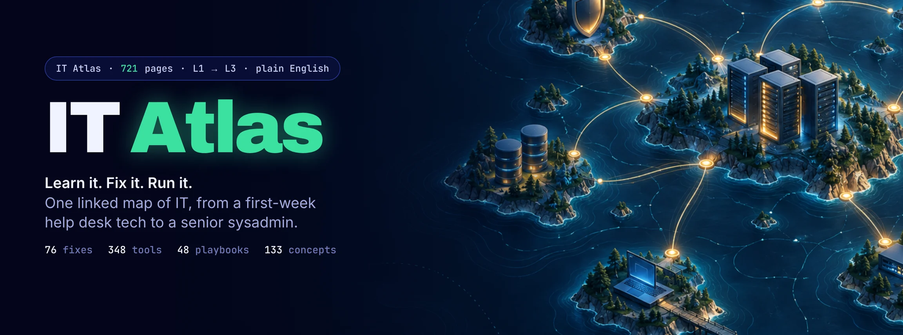
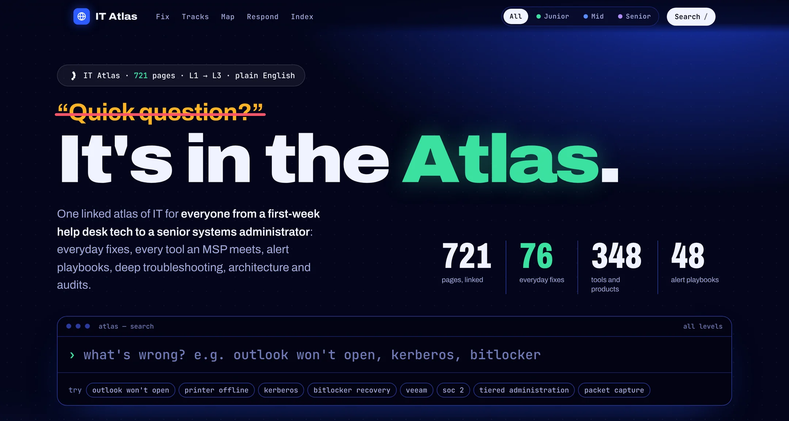
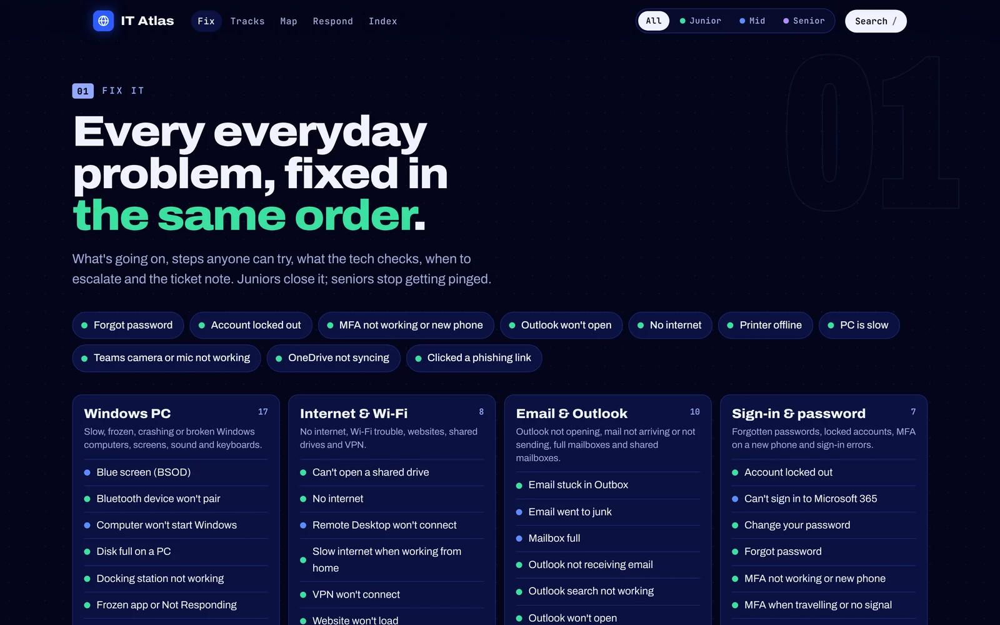
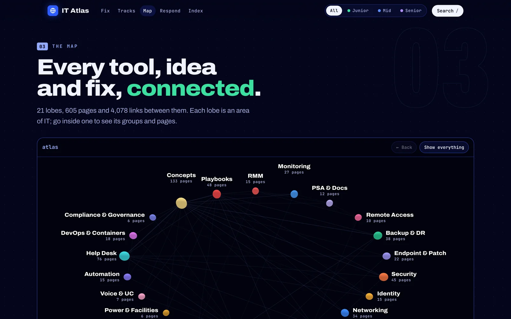
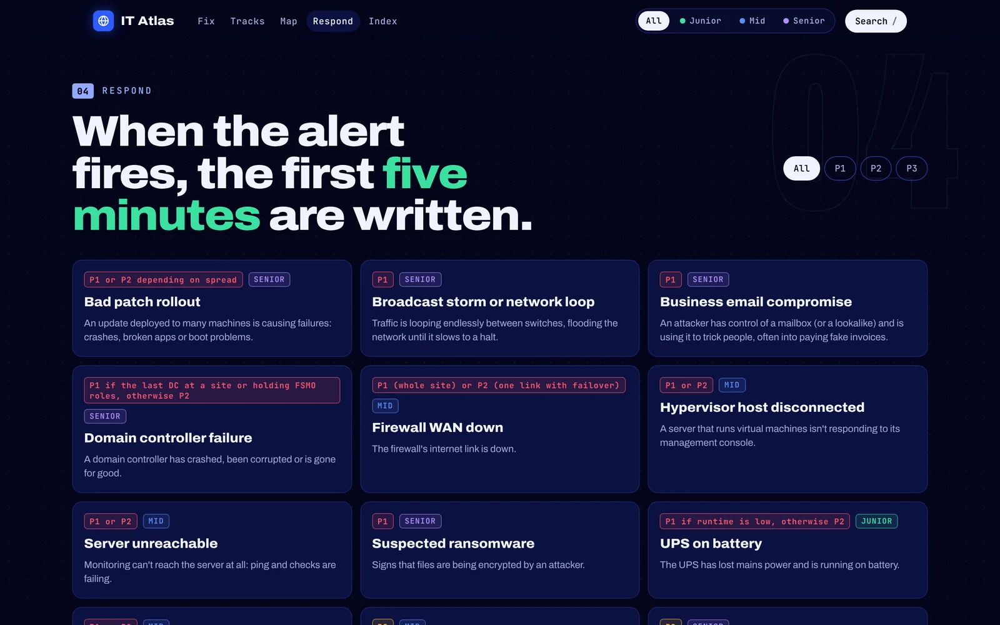
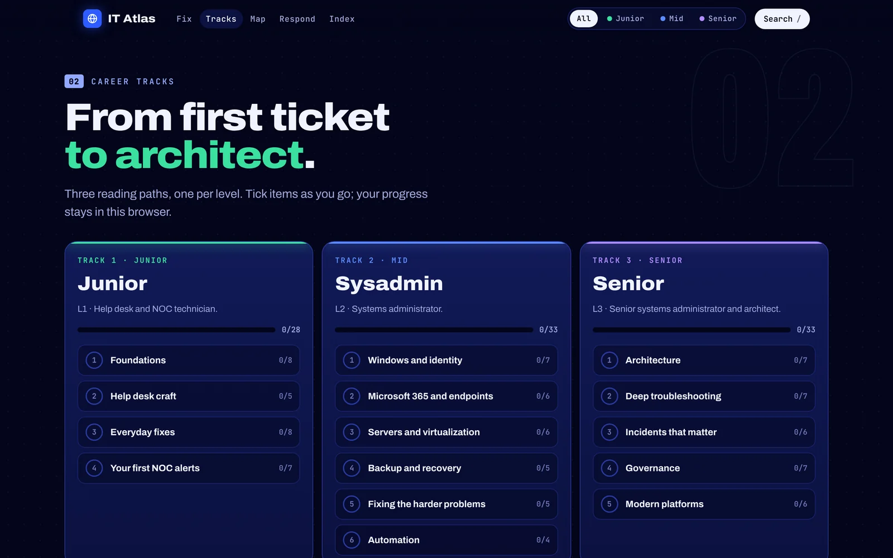

<p align="center">
  <a href="https://rehan-123.github.io/Atlas/"></a>
</p>

<p align="center">
  <a href="https://rehan-123.github.io/Atlas/"></a>
  <a href="vault/IT-Atlas/Start%20here.md"></a>
</p>

<p align="center">
  
  
  
  
  
  
  <a href="https://github.com/rehan-123/Atlas/actions/workflows/atlas-quality.yml"></a>
</p>

## “Quick question?” It's in the Atlas.

New techs ask the same questions every week, and seniors answer them between alerts. **Atlas writes each answer down once**: the safe first check anyone can try, what the tech checks next, when to escalate, and what to put in the ticket. Every page links to the tools, concepts and playbooks around it, so you can go from a symptom to the right next step without guessing.

It's an [Obsidian](https://obsidian.md/) vault you can read offline, plus a one-file interactive demo that opens in any browser.

<p align="center">
  <a href="https://rehan-123.github.io/Atlas/"></a>
</p>

## Take the tour

<table>
  <tr>
    <td width="50%" valign="top">
      <a href="https://rehan-123.github.io/Atlas/"></a>
      <br><b>Fix it.</b> 76 everyday problems, each fixed in the same order: what's going on, steps anyone can try, what the tech checks, when to escalate and the ticket note.
    </td>
    <td width="50%" valign="top">
      <a href="https://rehan-123.github.io/Atlas/"></a>
      <br><b>The map.</b> Every tool, idea and fix, connected. Open an area of IT to see its groups and pages, then follow the links.
    </td>
  </tr>
  <tr>
    <td width="50%" valign="top">
      <a href="https://rehan-123.github.io/Atlas/"></a>
      <br><b>Respond.</b> 48 alert playbooks. When the alert fires, the first five minutes are already written: what it means, why it matters, what to check.
    </td>
    <td width="50%" valign="top">
      <a href="https://rehan-123.github.io/Atlas/"></a>
      <br><b>Tracks.</b> Three reading paths, from first ticket to architect: Junior (L1), Sysadmin (L2) and Senior (L3), with progress you can tick off.
    </td>
  </tr>
</table>

## What's inside

| 721 | 76 | 348 | 133 | 48 | 90 | 13 |
| :---: | :---: | :---: | :---: | :---: | :---: | :---: |
| linked pages | help desk fixes | tools | concepts | alert playbooks | vendors | reference sheets |

Plus a [10-week learning path](vault/IT-Atlas/00%20Home/Learning%20path/Learning%20path.md), [three career tracks](vault/IT-Atlas/00%20Home/Career%20tracks/Career%20tracks.md), a [glossary](vault/IT-Atlas/40%20Reference/Glossary.md) and a map page for every area. Every page is tagged by level ([how levels work](vault/IT-Atlas/00%20Home/Notes%20by%20level.md)): **154** for Junior (L1 help desk and NOC), **396** for Mid (L2 sysadmin), **68** for Senior (L3) and **103** for everyone.

### Every area of IT

Tools by area, with how many each covers:

| Operations | Infrastructure | Security & engineering |
| :-- | :-- | :-- |
| [RMM](vault/IT-Atlas/01%20RMM/RMM.md) · 15 | [Networking](vault/IT-Atlas/09%20Networking/Networking.md) · 34 | [Security](vault/IT-Atlas/07%20Security/Security.md) · 45 |
| [Monitoring & observability](vault/IT-Atlas/02%20Monitoring/Monitoring%20%26%20Observability.md) · 27 | [Servers & OS](vault/IT-Atlas/10%20Servers%20%26%20OS/Servers%20%26%20Operating%20Systems.md) · 23 | [Identity & access](vault/IT-Atlas/08%20Identity/Identity%20%26%20Access.md) · 15 |
| [PSA & documentation](vault/IT-Atlas/03%20PSA%20%26%20Docs/PSA%20%26%20Documentation.md) · 12 | [Virtualization & storage](vault/IT-Atlas/11%20Virtualization%20%26%20Storage/Virtualization%20%26%20Storage.md) · 27 | [Compliance & governance](vault/IT-Atlas/19%20Compliance%20%26%20Governance/Compliance%20%26%20Governance.md) · 6 |
| [Remote access](vault/IT-Atlas/04%20Remote%20Access/Remote%20Access.md) · 10 | [Cloud & SaaS](vault/IT-Atlas/12%20Cloud%20%26%20SaaS/Cloud%20%26%20SaaS.md) · 20 | [Automation & scripting](vault/IT-Atlas/16%20Automation/Automation%20%26%20Scripting.md) · 15 |
| [Backup & DR](vault/IT-Atlas/05%20Backup%20%26%20DR/Backup%20%26%20DR.md) · 38 | [Databases & apps](vault/IT-Atlas/13%20Databases%20%26%20Apps/Databases%20%26%20Applications.md) · 8 | [DevOps & containers](vault/IT-Atlas/18%20DevOps%20%26%20Containers/DevOps%20%26%20Containers.md) · 18 |
| [Endpoint & patch](vault/IT-Atlas/06%20Endpoint%20%26%20Patch/Endpoint%20%26%20Patch%20Management.md) · 22 | [Power & facilities](vault/IT-Atlas/14%20Power%20%26%20Facilities/Power%20%26%20Facilities.md) · 6 |   |
|   | [Voice & UC](vault/IT-Atlas/15%20Voice%20%26%20UC/Voice%20%26%20UC.md) · 7 |   |

- **[Help desk fixes](vault/IT-Atlas/17%20Help%20Desk/Help%20Desk.md)** in 11 areas: Windows PC, email and Outlook, internet and Wi-Fi, sign-in and passwords, Microsoft 365 and Teams, printers and scanners, security and scams, software, phones and tablets, Macs, and new starters and leavers.
- **[Concepts](vault/IT-Atlas/20%20Concepts/Concepts.md)** in 12 groups, from IT basics, networking and Windows identity to security, backup, monitoring, cloud, architecture and advanced troubleshooting. Each one has an everyday analogy and a question to check yourself.
- **[Reference sheets](vault/IT-Atlas/40%20Reference/Reference.md)**: ports, Windows event IDs, log locations, agent and service names, product lifecycle dates, a vendor and acquisition map, an RCA format, and command cheat sheets for Windows, Linux, network devices, ESXi and Hyper-V, and Microsoft 365 PowerShell.
- **[Vendors](vault/IT-Atlas/50%20Vendors/Vendors.md)**: one page per vendor, linked to its products.

## How it works

<p align="center">
  
</p>

Every page follows the same shape for its type. A help desk fix starts with **Try this first** (safe for anyone) and moves to **If you're the tech**. A playbook starts with **What this alert means** and **Why it matters**. A tool page opens with **In plain words** before the technical detail, so a beginner and a senior engineer can both use the same page.

## Get started

**1. Try the demo, no install.** Open the [live demo](https://rehan-123.github.io/Atlas/), or download [`demo/IT-Atlas.html`](demo/IT-Atlas.html) and double-click it. It's a single file and works offline.

**2. Open the full vault in Obsidian.**

1. Install [Obsidian](https://obsidian.md/) and download or clone this repository.
2. In Obsidian, choose **Open folder as vault** and pick `vault/IT-Atlas/`.
3. Open [Start here](vault/IT-Atlas/Start%20here.md), then [Home](vault/IT-Atlas/00%20Home/Home.md). Turn on the **Dataview** community plugin for the live tables.

**3. Or let an installer do it.** These set up the vault in your Documents folder, offer to install Obsidian (for your user only on Windows, through Homebrew on macOS or Flatpak on Linux) and add the Dataview plugin. The Windows installer needs no admin rights. Read a script before you run it.

```powershell
# Windows
powershell -ExecutionPolicy Bypass -File .\setup-it-atlas.ps1
```

```bash
# macOS and Linux
bash setup-it-atlas.sh
```

To update later, run `update-it-atlas.ps1` or `update-it-atlas.sh`. They back up your vault first and keep anything you wrote under **Field notes**.

<details>
  <summary><b>Starting points inside the vault</b></summary>

| Open | Use it for |
| --- | --- |
| [Home](vault/IT-Atlas/00%20Home/Home.md) | Every area, concept, tool, reference and playbook from one map. |
| [How to use the IT Atlas](vault/IT-Atlas/00%20Home/How%20to%20use%20the%20IT%20Atlas.md) | Shortcuts, page types and experience levels. |
| [Learning path](vault/IT-Atlas/00%20Home/Learning%20path/Learning%20path.md) | Ten weeks from computer basics to NOC operations. |
| [Help desk](vault/IT-Atlas/17%20Help%20Desk/Help%20Desk.md) | Pick the symptom, follow the steps, know when to escalate. |
| [Playbooks](vault/IT-Atlas/30%20Playbooks/Playbooks.md) | Pick the alert and work the first five minutes. |
| [Tool database](vault/IT-Atlas/00%20Home/Tool%20database.md) | Every tool in one sortable table. |

</details>

## Kept accurate, with Claude Code

The vault ships with rules and commands for [Claude Code](https://claude.com/claude-code). Open a terminal in `vault/IT-Atlas/` and run `claude`:

| Command | What it does |
| --- | --- |
| `/add-tool` | Researches a tool from vendor docs and files it in the right area with its links. |
| `/add-playbook` | Writes a playbook for an alert, with concrete first checks. |
| `/verify` | Checks a page's facts against current vendor documentation and records the date and source. |
| `/gaps` | Lists thin areas and well-known tools or vendors that are missing. |
| `/lint` | Finds and fixes broken links and missing fields. |

The [rules](vault/IT-Atlas/CLAUDE.md) are strict: never invent ports, service names, paths, commands or event IDs; facts that change need a source and a verified date; and every page must link into the map. Every push runs the link and quality checks.

<details>
  <summary><b>Optional plugins and privacy</b></summary>

Dataview powers the live tables. Gesture Graph adds a 3D view of linked notes; its hand control is optional and asks for the camera only when you turn it on. Before enabling community plugins, read the [Gesture Graph privacy and network notes](vault/IT-Atlas/.obsidian/plugins/gesture-graph/README.md) and its [third-party notices](vault/IT-Atlas/.obsidian/plugins/gesture-graph/THIRD_PARTY_NOTICES.txt).
</details>

## Contributing

Corrections and practical additions are welcome. See [Contributing](CONTRIBUTING.md). Keep examples fictional: never commit real customer details, employer or host names, addresses, account identifiers, credentials, screenshots or incident records. To report something sensitive, see [Security](SECURITY.md).

Atlas is a learning and reference tool, not a replacement for your organization's procedures. Product details change, so check anything time-sensitive against current vendor documentation before you act. Bundled plugins keep their own licenses and notices.

---

<p align="center"><sub>Keep learning. Keep mapping. Find the next step.</sub></p>
