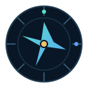

# Atlast · IT knowledge, connected

> A practical IT atlas for learning the fundamentals, fixing everyday problems, and finding your way through the tools and systems behind a modern IT operation.

**Start here:** [Open the interactive atlas demo](demo/IT-Atlas.html) · [Open the Obsidian vault](vault/IT-Atlas/Start%20here.md)

Atlast brings everyday help desk fixes, NOC playbooks, IT concepts, and technology references into one linked knowledge base. It is written for people starting out in IT as well as working support and operations teams.

## Explore

| Need | Start with |
| --- | --- |
| Learn IT from the beginning | [10-week learning path](vault/IT-Atlas/00%20Home/Learning%20path/Learning%20path.md) |
| Fix a day-to-day issue | [Help desk guides](vault/IT-Atlas/17%20Help%20Desk/Help%20Desk.md) |
| Respond to an alert | [Incident playbooks](vault/IT-Atlas/30%20Playbooks/Playbooks.md) |
| Understand a technology | [Concepts](vault/IT-Atlas/20%20Concepts/Concepts.md) |
| Look up a product or vendor | [Tool database](vault/IT-Atlas/00%20Home/Tool%20database.md) · [Vendors](vault/IT-Atlas/50%20Vendors/Vendors.md) |
| Find a port, event ID, or command | [Reference sheets](vault/IT-Atlas/40%20Reference/Reference.md) |

The vault currently includes **76 help desk guides**, **348 tool notes**, **133 concepts**, **48 playbooks**, **13 reference sheets**, and **170 vendor notes**. Notes connect to each other with Obsidian links, so you can move from an alert to the relevant tools, concepts, and next steps.

## Try the demo

Open [`demo/IT-Atlas.html`](demo/IT-Atlas.html) in a modern browser. It is a standalone interactive overview and does not need a build step or a server. The full working knowledge base is the Obsidian vault in `vault/IT-Atlas/`.

## Use the knowledge base

1. Install [Obsidian](https://obsidian.md/).
2. In Obsidian, choose **Open folder as vault** and select `vault/IT-Atlas/`.
3. Start at **Start here**, then open **Home** for the main map.

Dataview powers the live tables on the Home page and category maps. The included Gesture Graph plugin provides an optional 3D view; its hand-control feature asks for camera access only when enabled. See the plugin's [privacy and network notes](vault/IT-Atlas/.obsidian/plugins/gesture-graph/README.md) and [third-party notices](vault/IT-Atlas/.obsidian/plugins/gesture-graph/THIRD_PARTY_NOTICES.txt). Review bundled community plugins before enabling them.

### Install or update with a script

The repository also includes `setup-it-atlas.sh` and `setup-it-atlas.ps1` for first-time setup, plus matching `update-` scripts. They contain a compressed copy of the vault so they can install it without a separate download. Read the script before running it; the setup script can install optional software only after prompting, and the update script creates a backup before changing an existing vault.

## What's inside

- **Learn:** plain-language foundations, a 10-week path, and career tracks from junior technician to senior engineer.
- **Fix:** practical first checks and troubleshooting guides for common device, network, account, email, and security problems.
- **Respond:** incident playbooks with an initial response sequence for common NOC alerts.
- **Understand:** linked concepts covering networking, identity, security, cloud, operations, and architecture.
- **Look up:** product notes, vendors, ports, event IDs, logs, and command references.
- **Extend:** templates, a vault linter, a CSV export, and optional Obsidian plugins.

## Accuracy and safety

Technology changes quickly. Each note has update and verification fields; confirm current vendor behavior and local procedures before using a command or acting during an incident. The included material is educational and is not a substitute for your organization's change, security, backup, or incident-response procedures. Some notes are marked for verification.

## Contribute

Corrections and additions are welcome. Please read [CONTRIBUTING.md](CONTRIBUTING.md) before proposing changes. In particular, don't add real organization names, hostnames, addresses, credentials, customer data, or incident details to examples.

## Credits and licensing

The vault includes bundled Obsidian community plugins and their dependencies. Their notices and license information are included with each plugin. The Gesture Graph plugin's third-party notices are [here](vault/IT-Atlas/.obsidian/plugins/gesture-graph/THIRD_PARTY_NOTICES.txt). No project-wide license is included. Ask the maintainer before reusing or redistributing Atlast content; third-party components remain under their respective licenses.
